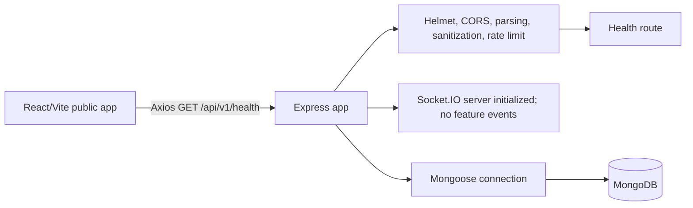

# FoodSurplus Architecture Overview

## Current implementation

FoodSurplus currently consists of a React/Vite public frontend and an Express/Mongoose backend foundation. The frontend uses `BrowserRouter` and `AppRoutes` to render a shared public layout, the landing page and a not-found page. A shared Axios client calls the backend health endpoint, and Tailwind provides the design system and responsive styles.

The Express app applies Helmet, configured CORS, JSON body parsing, cookie parsing, MongoDB sanitization, Morgan request logging outside test mode, a global API rate limit, the health route, not-found handling and centralized error handling. The server applies an optional development-only DNS override, connects to MongoDB, creates an HTTP server with Socket.IO, then starts listening. The health route reports the Mongoose connection state.

## Current implementation boundaries

- The only registered application API route is `GET /api/v1/health`.
- MongoDB is connected for the health-status foundation; there are no domain models or product data APIs.
- Socket.IO is initialized but has no feature events or authentication.
- Authentication, organization verification, role-based authorization, donations, claims, pickups, uploads, notifications, maps and administrator workflows are not implemented.
- Installed dependencies for planned functionality do not mean those features exist.

## Planned target architecture

The architecture documents describe the intended product, not the current behavior. Future requests will use feature API modules in the frontend and Express routes/controllers/services/validators/models in the backend. The server will enforce validation, privacy, authorization and domain rules. MongoDB transactions are planned for claim allocation and other coordinated state changes. These features must not be represented as implemented until delivered and verified.

## Detailed architecture documents

- [Product requirements](docs/architecture/PRODUCT_REQUIREMENTS.md)
- [System architecture](docs/architecture/SYSTEM_ARCHITECTURE.md)
- [Frontend architecture](docs/architecture/FRONTEND_ARCHITECTURE.md)
- [Backend architecture](docs/architecture/BACKEND_ARCHITECTURE.md)
- [Database design](docs/architecture/DATABASE_DESIGN.md)
- [Planned API specification](docs/architecture/API_SPECIFICATION.md)
- [Authentication and security design](docs/architecture/AUTH_AND_SECURITY.md)
- [UI design system](docs/architecture/UI_DESIGN_SYSTEM.md)
- [Development roadmap](docs/architecture/DEVELOPMENT_ROADMAP.md)
- [Testing strategy](docs/architecture/TESTING_STRATEGY.md)
- [Current project status](PROJECT_STATUS.md)
