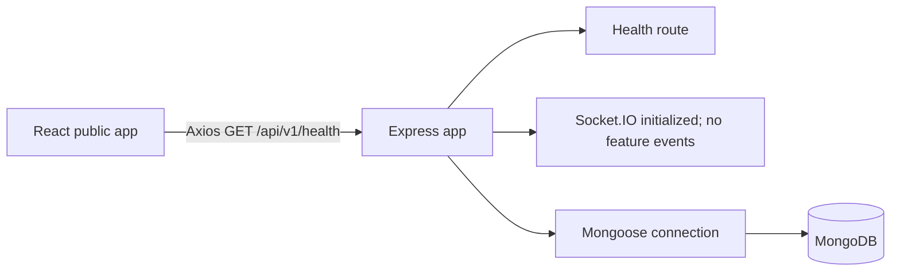
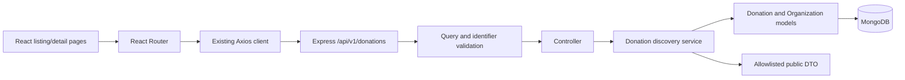

# FoodSurplus System Architecture

## Status and principles

Phase 1 is implemented; Phase 2 is finalized but planned. Preserve React/Vite, Express, Mongoose and MongoDB. Use the existing layered structure and verify current dependency compatibility before any future tooling changes. Do not treat planned models or workflows as implemented.

## Existing system

The health route is the only current application API route. The existing frontend has the public shell and health-status request. M1 adds the Organization and Donation domain models and exact-quantity utilities; donation APIs remain unimplemented.

## Phase 2 target request and data flow

1. Responsive React listing and detail pages call the existing Axios client.
2. Express validates query parameters and identifiers, then routes public requests through controllers and services.
3. Services query MongoDB for records whose status is Available, `availableUntil` is later than server time, and `availableQuantity` is positive.
4. Explicit public DTO allowlists return only the approved donation fields and nested Organization `name`. Private fields and internal state are never serialized.
5. Listing responses apply token-based MongoDB text search, the seven approved categories from `shared/donationCategories.mjs`, bounded pagination and stable sorting.
6. Dates persist as UTC instants and are serialized consistently as ISO 8601 UTC; the browser formats local time without affecting availability.

## Architecture choice

Extend the current backend top-level layers (`routes`, `controllers`, `services`, `models`, `validators`, `middleware`, and `utils`) and frontend `routes`, `pages`, `components`, and `api` directories. Keep query/domain logic out of route handlers and presentation components. Avoid a broad restructure.

## Phase 2 boundaries

- Phase 2 includes public read-only discovery and a minimal Organization record for donation association and public display name.
- Phase 2 excludes authentication, registration, verification, donor publishing, claims, reservations, pickup scheduling, admin dashboards, location discovery, uploads/Cloudinary, Socket.IO notices and real-activity impact analytics.
- Seed data is development-only, idempotent, production-blocked, never run at server startup, and must not delete unrelated records.
- Public availability is server-derived; there is no client availability query parameter.
- No public location precision has been approved. Do not expose location or add location-based discovery.

## Reliability, privacy and pending decisions

The public Donation DTO is exactly `id`, `title`, `description`, `category`, decimal-string `quantity`, decimal-string `availableQuantity`, `quantityUnit`, `availableUntil`, optional `foodExpiryAt`, optional `preparedAt`, optional `packedAt`, and nested Organization `name` only. Exclude Donation status and Organization `_id`, `type`, and timestamps, as well as exact address/coordinates, private contacts, pickup instructions, verification evidence, moderation details and internal claim/state data. Missing, expired or unavailable records return the same generic not-found response.

Use Decimal128 for exact quantities, validate owner-approved unit precision, accept decimal strings, and serialize quantities as strings. The sole public Organization field is `name`; `type` is an unrestricted string and is not a category enum. The only status defined for Phase 2 discovery is Available; do not define the future lifecycle.

Donation errors use the approved business envelope and initial mapping in [API specification](API_SPECIFICATION.md), with details null. Error formatting must not change the current health response or unrelated unknown-route behavior.

Candidate indexes (`status + availableUntil`, `category + status + availableUntil`, and text on `title + description`) require query-plan validation; no definitions or query plans are finalized. Food-safety/eligibility and handling requirements remain pending. Location discovery is excluded in Phase 2. Preserve the current health response shape.
