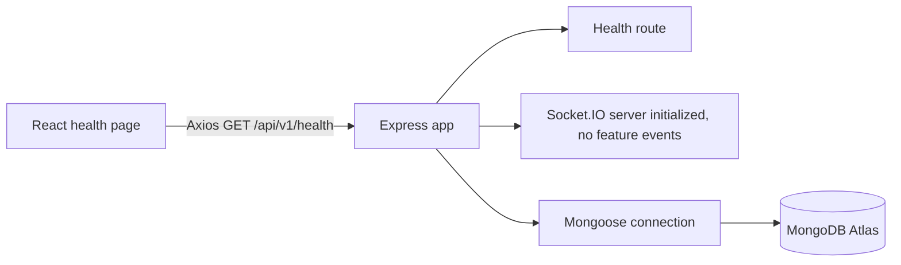
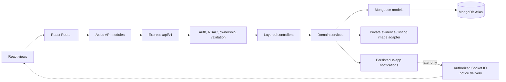

# FoodSurplus System Architecture

## Status and principles

This document separates the existing scaffold from the approved MVP target. The target is not implemented. Preserve React/Vite, Express, Mongoose, MongoDB Atlas and Socket.IO. Build incrementally, enforce all business rules on the server, and do not introduce dependencies without a concrete need and approval.

## Existing system

The only API route is `GET /api/v1/health`. The backend validates environment configuration, configures middleware and waits for MongoDB before listening. Socket.IO is created without application event/auth behavior. There are no feature models, auth flows, uploads, notifications or user-facing product workflows.

## Target request and data flow

1. React Router renders public or role-specific views. Client route guards improve navigation only.
2. Feature API modules call the existing Axios client; public listing responses contain approximate location only.
3. Express applies Helmet, explicit CORS, parsing limits, sanitization, route-specific rate limits, authentication, authorization and Zod validation.
4. Controllers translate HTTP requests; services enforce membership, verification, ownership, eligibility and state transitions.
5. Mongoose models and MongoDB persist state. Claim reservation/release and associated claim writes use an Atlas transaction with conditional state updates and idempotency.
6. Persist in-app notifications in MongoDB. REST is authoritative in the MVP. Socket.IO is deferred; later it may deliver minimal notices to authorized recipients after transaction commit.

## Architecture choice: extend the existing layered scaffold

Use the existing top-level backend layers: `config`, `routes`, `controllers`, `services`, `models`, `validators`, `middleware`, `sockets`, `jobs`, and `utils`. Keep files feature-named (for example `donationService.js`, `claim.routes.js`) and group related validators/services by feature within those layers. Do not migrate to a second `modules/<feature>/<layer>` tree. The current `.gitkeep` directories are scaffolding, not implemented features.

Frontend should extend its existing `routes`, `pages`, `components`, `api`, `context`, `hooks` and `utils` directories. Add only the page/layout/component separation needed by the next phase; no broad restructure is required.

## Approved MVP domain rules

- A normal user has one primary Donor or NGO role and one organization membership. Admin is separately provisioned. Keep membership as a relationship so multi-organization support can be added later.
- Both donor and NGO organizations must be approved and active. Donors may publish; verified NGOs may claim.
- One donation can have one active all-or-nothing claim. Claim request reserves the full donation immediately; donor approval is required. Rejection, eligible cancellation and pending timeout release the reservation atomically and idempotently.
- Donation states: `available → reserved → claimed → completed`; other terminal states `cancelled`, `expired`. Pending release returns to `available` only if the listing is still eligible/active and before its pickup deadline. No partial claim state.
- Claim states: `pending → approved | rejected | cancelled | expired`; `approved → completed | cancelled | exceptionReview`; exception review resolves to completed or cancelled. A missed approved pickup never automatically republishes food.
- Pickup states: `awaitingSlotSelection → scheduled → readyForPickup → completed`; rescheduling is explicit; a missed/disputed slot enters exception review; cancellation does not implicitly release a donation without the eligibility rule.
- Keep collection/pickup deadline separate from food expiry. Store exact locations privately and return approximate coordinates publicly. Reveal exact pickup details only to the NGO with an `approved` claim and authorized admins.

The canonical transitions and field requirements are in [Product requirements](PRODUCT_REQUIREMENTS.md); database/API/test documents must use the same terms.

## Security and reliability boundaries

- CORS is not authorization or CSRF defense. Current development-only loopback CORS behavior and production `CLIENT_URL` policy remain as implemented; do not widen production origins.
- `DEV_USE_PUBLIC_DNS` is a temporary development-only Windows workaround, defaults off, and is rejected in test/production. Do not deploy it enabled; use platform-managed DNS and remove it when fixed.
- Cloudinary credentials stay server-side. Public donation images and private verification evidence use distinct authorization/access rules.
- Keep health compatibility with the current frontend; use the standardized envelope for new business routes.
- Current server has no readiness/liveness split, shutdown handling, retry/backoff, production structured logging or operational deployment configuration. Define those before deployment.
- Do not make socket delivery the source of truth. Persist notification/state first, then offer a future authorized realtime notice.
